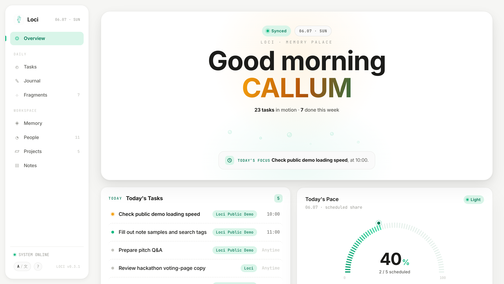

<p align="center">
  
</p>

<p align="center">
  <strong>A local memory and data layer shared across agents. AI helps you capture it; you can inspect and edit it.</strong>
</p>

<p align="center">
  <a href="LICENSE"></a>
  <a href="https://github.com/codesstar/loci/stargazers"></a>
  
</p>

<p align="center">
  <a href="README.md">中文</a> | English
</p>

## What is Loci?

AI tools often keep separate memories. Switching agents may mean explaining your preferences, tasks, and project background again, while scattered records are hard to organize.

Loci keeps this information in your own local “brain” directory. Instructions in each agent's native entry point describe where to read, what is worth saving, and how to write it. Agents connected to the same brain can retrieve shared context that has already been saved.

Memory, tasks, schedules, contacts, and knowledge use Markdown, JSON, and attachments. Open the files directly or inspect and edit them through the Dashboard. No external database or cloud memory service is required; the Dashboard is a local Node.js service.

## What can it do?

| Capability | Use |
| --- | --- |
| Personal memory | Save names, language preferences, personal facts, reflections, and decisions; retrieve them when relevant |
| Tasks and schedules | Manage todos, meetings, and time blocks; a timed todo remains a task and is not automatically copied to the calendar |
| Project context | Keep state, technical decisions, and development todos in the project repository; the brain holds an index |
| People and places | Record contacts, relationships, interactions, and relevant locations |
| Knowledge | Collect links, scraps, and attachments; index your own notes and research |
| Journals and review | Inspect activity records and organize recent work and saved information |

For example, tell a connected agent:

```text
Use English when replying to me.
Remind me to send the materials tomorrow at 9 AM.
Save this link with the note “interview reference”.
Remember this project, then tell me where we left off.
```

The agent's file and command tools perform the operations. Results depend on instruction loading, access to the brain, and correct execution; installing instruction files does not force a model to follow them.



## Quick start

You need Node.js 18 or later and an agent that can access local files and run commands.

### Setup wizard

```bash
npx create-loci
```

The browser wizard creates a brain and offers connections for Claude Code, Codex, and WorkBuddy. For terminal setup:

```bash
npx create-loci --cli
```

On Windows, run the browser wizard from PowerShell or Command Prompt. Use WSL/Git Bash for the optional terminal wizard and shell scripts.

### Ask your agent to install it

Paste this into Claude Code or Codex:

```text
Install Loci: https://github.com/codesstar/loci
Clone the repository, follow docs/AI-INSTALL.md, and verify the connection.
```

### Manual setup (macOS / Linux / WSL / Git Bash)

```bash
git clone https://github.com/codesstar/loci.git ~/loci
cd ~/loci
./setup.sh
```

For scripted setup, see `./setup.sh --help` and the [AI installation guide](docs/AI-INSTALL.md). Follow the [getting started guide](docs/getting-started.md) for a full walkthrough.

### Open the Dashboard

After installation, run `loci`. You can also start it directly from the brain directory:

```bash
node .loci/dashboard/server.js
```

Open [localhost:8765](http://localhost:8765). Keep the local service running for its UI and reminder functions; saving a reminder does not prove that a device received a notification.

## How agents share memory

The repository includes connections for Claude Code, Codex, and WorkBuddy. Each tool has different instruction paths, hook support, and permissions. When switching tools, confirm that both connect to the same brain and can access its data and required commands.

```text
Claude Code / Codex / WorkBuddy
              │
    Instructions and read/write tools
              │
   Shared local memory, tasks, and knowledge
              ▲
          Dashboard
```

Startup provides lightweight context; other content is read when a request needs it. The full history is not loaded into every conversation. Full project memory stays in its own repository and is found through the brain's index.

## Data and privacy

Files stay on your machine and can be backed up, inspected, and moved. Loci does not require a separate cloud memory service. When an agent calls a model, accesses the network, or uses other tools, data handling follows the configuration of that agent and those services. Local storage does not imply fully offline model use.

Loci is an MIT-licensed open-source project. Models and third-party services may have their own charges.

## Documentation and contributions

- [English getting started guide](docs/getting-started.md) · [中文指南](docs/getting-started.zh-CN.md)
- [AI installation](docs/AI-INSTALL.md)
- [Dashboard](docs/dashboard.md) · [API](docs/api.md)
- [Example brain](examples/alex/)
- [Contributing](CONTRIBUTING.md) · [MIT License](LICENSE)

Report reproducible problems and suggestions in [Issues](https://github.com/codesstar/loci/issues), or submit a pull request.
